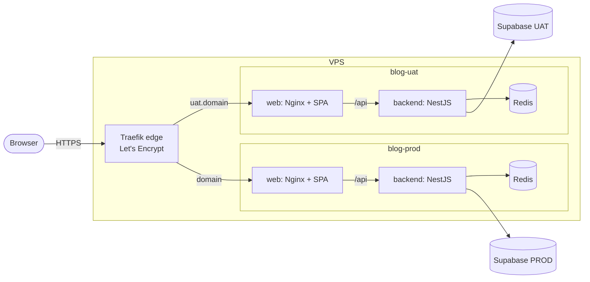

# Blog

A blog with a public site, an admin panel and a CI/CD pipeline that deploys to UAT and production.

| Part | Stack |
| --- | --- |
| `frontend/` | Vite + React 19 + TypeScript SPA, TanStack Query, Tailwind; served by Nginx |
| `backend/` | NestJS 12 + Prisma 7 REST API (`/api`) |
| Database | PostgreSQL 17 — local container in development, Supabase in UAT/production |
| Cache | Redis 7 — post cache, rate limits, refresh tokens |
| `deploy/` | Docker Compose files for the server, Traefik edge proxy, deploy scripts |
| CI/CD | GitLab CI from the shared [`cicd-templates`](https://gitlab.com/NguyenHuyHoang170702/cicd-templates) project |



## Features

- Posts written in Markdown (sanitized rendering, code highlighting), cover images, draft/published status
- Categories, tags, title search, pagination
- Guest comments held for moderation
- Admin login with short-lived JWT access tokens and rotating refresh tokens (httpOnly cookie, stored in Redis; reuse revokes every session)
- Image upload with content-based type detection (JPEG, PNG, WebP, GIF; 5 MB)
- Redis-backed rate limits: 100 requests/min per IP, 5 logins/min, 3 comments/min

## Quick start (Docker)

```bash
cp .env.example .env      # adjust values if you like
docker compose up -d --build
```

Open http://localhost:8080 and the admin panel at http://localhost:8080/admin (`ADMIN_EMAIL` / `ADMIN_PASSWORD` from `.env`). A sample post is created on first start.

## Native development

```bash
docker compose up -d postgres redis        # data services only
cd backend && cp ../.env.example .env && npm ci && npx prisma generate \
  && npx prisma migrate deploy && npm run build && npm run seed && npm run start:dev
cd frontend && npm ci && npm run dev       # http://localhost:5173
```

## Environment variables (local)

| Variable | Used by | Purpose |
| --- | --- | --- |
| `POSTGRES_IMAGE`, `POSTGRES_USER`, `POSTGRES_PASSWORD`, `POSTGRES_DB` | Compose | Local database; keep the image's major version equal to Supabase's |
| `DATABASE_URL` | backend | Runtime connection (Supabase: transaction pooler) |
| `DIRECT_URL` | backend, Prisma CLI | Migrations (Supabase: session pooler) |
| `REDIS_URL` | backend | Redis connection |
| `JWT_ACCESS_SECRET`, `JWT_REFRESH_SECRET` | backend | At least 32 characters each |
| `ADMIN_EMAIL`, `ADMIN_PASSWORD` | seed | Admin account (password ≥ 12 characters) |
| `PORT`, `CORS_ORIGIN`, `UPLOAD_DIR` | backend | Native development only; Compose sets its own values |
| `SEED_SAMPLE_DATA` | seed | `true` creates a sample post when there are none |

Server variables are listed in [docs/deploy.md](docs/deploy.md).

## Checks

| | Backend | Frontend |
| --- | --- | --- |
| Lint | `npm run lint` | `npm run lint` |
| Types | `npm run typecheck` | `npm run typecheck` |
| Tests | `npm test`, `npm run test:e2e` (needs Postgres + Redis) | `npm test` |
| Build | `npm run build` | `npm run build` |

## Documentation

- [API](docs/api.md)
- [Git flow and CI/CD](docs/git-flow.md)
- [Deployment](docs/deploy.md)
- [Security and secrets](docs/security.md)

## Secret scanning

Install the pre-commit hook once per clone so secrets are blocked before they are committed:

```bash
pipx install pre-commit
pre-commit install
```

The pipeline runs the same gitleaks scan on every push.
