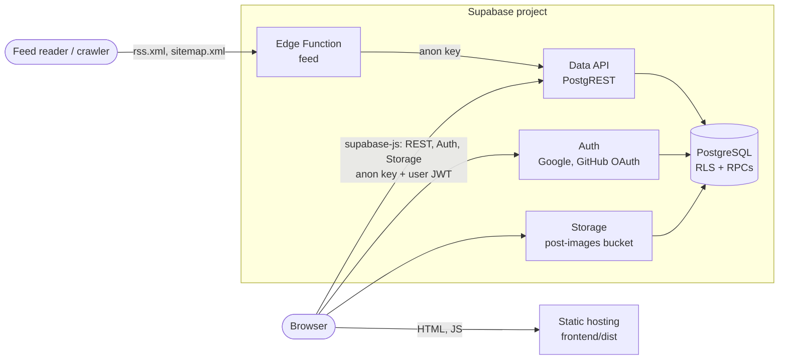

# L2M Blog

A multi-author Vietnamese blog: a static React single-page app that talks directly to Supabase (PostgreSQL with row-level security, Auth, Storage, Edge Functions). There is no application server: every access rule lives in the database.

## Features

**Readers**
- Home page with one column of posts, category, tag and author pages (`/u/:id`), pagination.
- Search over title, excerpt and content that ignores case and Vietnamese accents ("lap trinh" finds "Lập trình").
- Post page: Markdown (sanitized, code highlighting), 16:9 cover, reading time, table of contents for h2/h3, view and like counts, related posts (same category or tag).
- Comments without an account, shown immediately, with one level of replies; a report button on posts and comments.
- RSS feed and `sitemap.xml`.

**Authors** (sign in with Google or GitHub; the first sign-in creates the account)
- Markdown editor with toolbar, shortcuts, live preview and one cover image per post (cropped to 16:9 in the browser).
- Publish now, save a draft, or schedule publishing for a later time.
- The editor autosaves to the browser every few seconds and offers the copy back after a crash or an expired session.
- Dashboard: own posts with views and likes, comments on own posts (hide, show again, delete), profile (display name, avatar URL).
- Only the author edits a post; the author or an admin deletes it (from the post page or the post list).

**Admins**
- Categories and tags.
- Every post and comment.
- Report queue (`/dashboard/reports`): hide or delete the reported content, mark the report resolved or dismissed.
- Members (`/dashboard/members`): search by name or email, suspend or restore an account. A suspended member can still read and sign in but cannot write, upload, like or edit their profile.

**Abuse limits** (enforced in the database): 3 comments a minute and 5 reports per 10 minutes per client address, 10 new posts and 30 image uploads per hour per author, views counted once per address, post and hour, 2 MiB images (WebP, JPEG, PNG, GIF).

## Architecture



- **Frontend** (`frontend/`): Vite + React + TypeScript, TanStack Query, Tailwind. `src/api/endpoints.ts` is the only data layer; it shapes queries and maps rows but never decides access. Production builds add a strict CSP meta tag, `404.html` for SPA deep links, the RSS `<link>` and `robots.txt`.
- **Database** (`supabase/migrations/`): tables `posts`, `categories`, `tags`, `post_tags`, `comments`, `profiles`, `post_stats`, `post_likes`, `reports`. Row-level security decides who reads and writes what: visitors read published posts whose publish time has passed; members write only their own posts, tags and images; post authors moderate comments on their posts; admins (`private.site_admins`) manage everything. Guest-facing writes go through `security definer` RPCs with validation and rate limits (`submit_comment`, `report_content`, `record_post_view`); admin RPCs (`admin_list_users`, `admin_set_suspended`) check the caller first. The `private` schema (admin registry, suspensions, rate-limit counters) is not exposed through the API.
- **Storage**: public `post-images` bucket; each member writes only inside a folder named after their user id. Replaced or orphaned covers are deleted by the client when a post is saved or deleted.
- **Edge Function** `feed` (`supabase/functions/feed`): serves `rss.xml` and `sitemap.xml` from published posts, with no JWT required.

## Repository layout

| Path | Contents |
| --- | --- |
| `frontend/` | The SPA (`src/pages`, `src/components`, `src/api`, `src/lib`), Vitest tests |
| `supabase/migrations/` | Schema, RLS, RPCs, in order |
| `supabase/tests/database/` | pgTAP tests for access rules and functions |
| `supabase/functions/feed/` | RSS and sitemap Edge Function |
| `supabase/config.toml`, `supabase/seed.sql` | Local Supabase stack and local-only seed data |
| `scripts/` | Operator SQL (grant or revoke admin), embedded database test runner |
| `docs/` | Product ideas backlog, security notes, git flow |
| `deploy/`, `docker-compose.yml`, `frontend/Dockerfile`, `frontend/nginx/` | Earlier VPS/Docker setup from the NestJS version, not used by the Supabase app (see Status) |

## Local development

Requirements: Node.js 22+, Docker (for the local Supabase stack).

```bash
npm ci                          # Supabase CLI and database test tools
npx supabase start              # local Supabase: API on http://127.0.0.1:54321, Studio on :54323
npx supabase db reset           # apply migrations and supabase/seed.sql

cd frontend
cp .env.example .env.local      # then paste the anon key printed by: npx supabase status
npm ci
npm run dev                     # http://localhost:5173
```

Sign in at `/login` with the seeded admin `admin@example.com` / `local-dev-admin-password` (local only). Google and GitHub sign-in need OAuth apps: copy `supabase/.env.example` to `supabase/.env`, fill in the client IDs and secrets, then restart the stack. To try the feed locally, run `npx supabase functions serve` and open `http://127.0.0.1:54321/functions/v1/feed/rss.xml`.

Schema changes go in a new file under `supabase/migrations/` (`npx supabase migration new <name>`); never edit a migration that has been applied to a shared environment.

## Usage guide

1. **Read**: open the home page, filter by category or tag, or search. On a post, use the table of contents, like it (signed in), comment or reply without an account, or report it.
2. **Write**: sign in with Google or GitHub and click **Viết bài**. Write Markdown, drop or paste an image to set the cover, pick a category and tags. **Đăng bài** publishes now; filling **Hẹn giờ đăng** publishes later; **Lưu nháp** keeps it private. Leaving with unsaved changes asks first, and an autosaved copy is offered when you come back.
3. **Manage**: `/dashboard` shows your posts (with views and likes), the comments on them and your profile. Edit or delete a post from the list or from its page.
4. **Administer**: grant the first admin with `psql "$DIRECT_URL" -v "email=<email>" -f scripts/bootstrap-site-admin.sql` (revoke with `scripts/revoke-site-admin.sql`). Admins see **Quản trị** in the dashboard menu: categories, tags, reports and members.

## Checks

| Check | Command | Where |
| --- | --- | --- |
| Lint (oxlint + Prettier) | `npm run lint` | `frontend/` |
| Types | `npm run typecheck` | `frontend/` |
| Unit and component tests | `npm test` | `frontend/` |
| Build | `npm run build` | `frontend/` |
| Database tests without Docker (PGlite) | `npm run db:test:embedded` | repository root |
| Database tests on the local stack | `npm run db:test` | repository root |

## Deployment

Each environment (UAT, production) is its own Supabase project plus a static host for `frontend/dist`.

1. Create the Supabase project, link it and apply migrations: `npx supabase link --project-ref <ref>`, then `npx supabase db push` (never run `seed.sql` there).
2. Auth: set the Site URL to the site origin, add `<site>/auth/callback` to the redirect URLs, and enable Google and GitHub with that environment's OAuth apps.
3. Feed: `npx supabase secrets set SITE_URL=https://<domain>`, then `npx supabase functions deploy feed --no-verify-jwt`.
4. Build the frontend with that project's `VITE_SUPABASE_URL` and `VITE_SUPABASE_ANON_KEY` (`npm run build` in `frontend/`) and publish `frontend/dist` to any static host; `404.html` and `public/_redirects` cover SPA routing.
5. Grant the first admin (Usage guide, step 4).

Apply migrations before publishing a frontend that needs them. Secrets (database password, service key, OAuth secrets) never go in the repository: only `*.example` files are committed.

## Status

- The app runs fully on Supabase; the NestJS backend was removed. The VPS/Docker files (`deploy/`, `docker-compose.yml`, `frontend/Dockerfile`, `frontend/nginx/`) and `docs/api.md`, `docs/deploy.md`, `docs/security.md` and `AGENTS.md` still describe that earlier stack and are due for removal or rewrite.
- `.gitlab-ci.yml` still includes the earlier fullstack pipeline template; a pipeline for static hosting with Supabase migrations is planned.
- Not done yet: a scheduled clean-up of cover images uploaded but never saved. More ideas are in `docs/ideas.md`.
